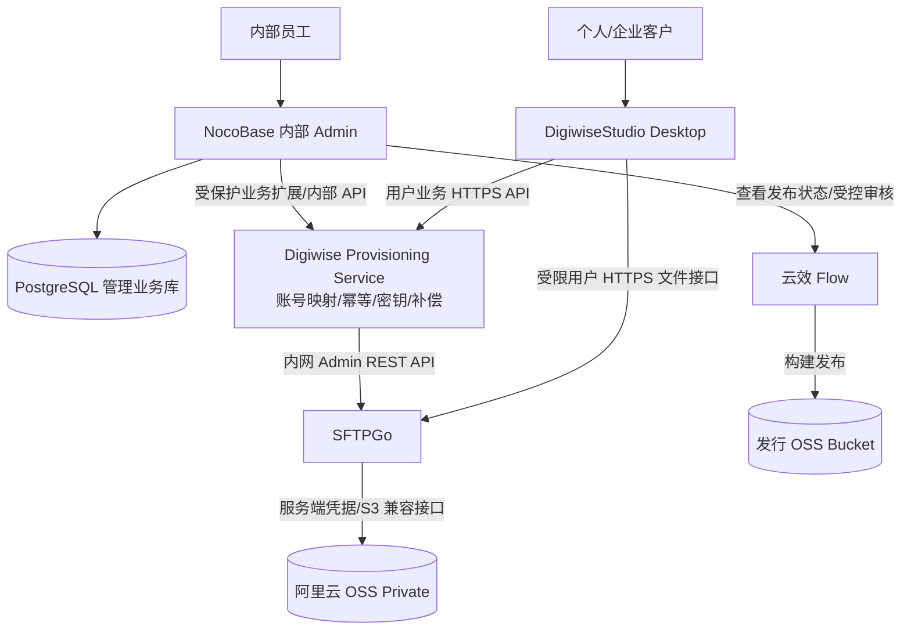

# ADR-0002：评估 NocoBase 作为 Digiwise 内部管理后台

- 日期：2026-11-10
- 状态：候选方案 / AI 优先评估 NocoBase 3 Core Beta；2.2 Stable 作为生产保守备选 / **未部署及未选型**
- 涉及：Digiwise Admin、Digiwise Cloud API、SFTPGo Admin API、用户/企业/工作空间、发布管理
- 关联：[总体架构](../architecture/digiwise-platform-and-oss.md)、[ADR-0001 文件面采用 SFTPGo](0001-sftpgo-file-plane.md)

## 1. 需求边界与候选方案

已确定：
- 个人与企业用户使用 DigiwiseStudio 桌面 IDE，不提供客户 Web 门户。
- 内部团队需要用户、Organizations、Workspace、成员/席位、许可证、容量策略、版本发布、审计和工作流管理。
- 文件操作由 SFTPGo 执行，实际对象存放于阿里云 OSS Private；客户不可直接访问 OSS 或取得 SFTPGo 管理员密钥。
- 正在比较 **NocoBase + SFTPGo + OSS** 与此前 **Ant Design Pro + NestJS + SFTPGo + OSS**。

NocoBase 自身基于 Node.js 技术体系，可承担内部 Admin 的界面、数据模型、权限和部分业务工作流；不需要再为同类后台页面搭建一套完全独立的 Ant Design Pro 管理端。

## 2. 推荐架构（待 PoC）

### 责任划分

| 组件 | 职责 | 不做 |
| --- | --- | --- |
| NocoBase | 内部管理 UI、客户与组织记录、配额策略、审批、后台操作权限和展示 | 不承担 GB 级文件传输，不作为面向所有桌面客户的唯一公共鉴权入口 |
| Digiwise Provisioning/API（精简） | 桌面身份/令牌桥接、用户与组织开通、SFTPGo 账号映射、幂等补偿、撤销会话、敏感审计 | 不提供重复的内部后台页面，不转发文件流 |
| SFTPGo | 用户文件接口、SFTP/WebDAV（按需）、虚拟目录/共享、实际文件使用计数及文件操作审计 | 不维护 Digiwise 套餐、订单与组织合同 |
| OSS Private | 用户数据对象、服务端存储与生命周期 | 不直接向客户端授权上传下载 |
| 云效 Flow | 构建/制品/发布 | 不管理客户空间 |

### 为什么保留精简业务 API

NocoBase 后台角色和内部会话不应直接暴露给所有桌面客户；即使 NocoBase 支持 HTTP API，也需要设计客户端的登录、令牌生命周期、SFTPGo User API 认证、用户/企业空间切换、成员权限撤销与并发补偿。可以实现成 NocoBase 后端插件或独立最小 Node 服务，具体部署由 PoC 决定。

严禁在 NocoBase 可公开查询的业务表中保存 SFTPGo Admin Token。密钥应在受控后端配置/密钥服务中管理。

## 2.1 版本选型修订：以 AI 开发为优先（2026-11-10）

**修订建议：如果开发主要由 Codex / Claude Code 和项目级 Skills 驱动，优先使用 NocoBase 3 Core Community 的隔离测试环境进行 PoC；NocoBase 2.2.41 Community Stable 保留为近期生产部署需要稳定可视化配置时的备选。** 此建议替代此前“一律只用 2.2.41”的判断；不是批准将 Beta 直接上线。

| 判断依据 | NocoBase 2.x | NocoBase 3 |
| --- | --- | --- |
| 工作模式 | 浏览器中可视化配置数据、表单、页面、工作流 | 应用代码驱动；Agent 编写页面、接口、逻辑，使用 Core 基础模块 |
| AI 开发与 Skills | 有 AI 辅助/插件能力，代码开发需独立组织 | 原生提供 Agent Skills、CLI、可测试的项目源码及开发约定 |
| 运行稳定性（2026-11-10） | 2.2 Stable | **仍为 Beta**，接口和依赖迭代频繁 |
| 授权 | 2.x Community / 付费插件需按版本核对 | **Core Community 免费**，使用自选 Codex/Claude Code；**Studio 是独立商业协作平台**，并非使用 AI 编程的前提 |

**重要区别：NocoBase 3 Core（免费）≠ NocoBase Studio（商业版）。** 小团队可以在 Core 项目目录使用现有 Codex/Claude Code 开发，并自行管理 Git、CI 和评审；若需要 Studio 协调多 Agent 任务、审查、发布，再单独评估许可证成本。

**首个 AI PoC：** 使用固定、经核对的 NocoBase 3 Beta 版本，在非生产环境让 Agent 实现企业列表、新增企业、邮箱审核状态、Workspace 配额界面和受保护的 SFTPGo Admin API 集成；复用仓库的 docs-first、云存储安全和 MCP/发布 Skills 规范。验证 Core 授权、API、用户/组织权限、数据库迁移、安全、自动化测试和可回滚发布。禁止管理员 Token 进入桌面端；客户端仍只访问 Digiwise Public API 和 SFTPGo 用户级文件 API。

**上线门槛：** 在 NocoBase 3 的授权、版本稳定性、API/Schema 兼容性、迁移与可恢复备份、真实业务权限与 SFTPGo 集成测试满足要求后再决定是否生产部署。若 3 Beta 在现阶段不足以承担正式客户开通服务，应先在独立测试环境迭代，生产可选 2.x Stable；**不要假设 2.x 直接升级至 3 而无需重构/迁移**。

官方依据：
- NocoBase 3 AI 应用与 Core：https://docs.nocobase.com/getting-started/what-is-nocobase/
- Core 使用现有 Coding Agent，无需 Studio：https://docs.nocobase.com/faq/core-and-studio/
- 3 Core / Studio 授权：https://www.nocobase.com/pricing/
- NocoBase 3 代码应用开发：https://docs.nocobase.com/core/developing-apps/overview/
- NocoBase 正式/预发布记录：https://github.com/nocobase/nocobase/releases

## 3. 官方版本差异（必须锁定版本）

NocoBase 2.x 与 3 的实现体系已有差异，不能将两套文档混用：

- NocoBase 2.x：基础用户、权限、工作流及 **Workflow HTTP Request** 为 Community；**Workflow Approval** 为 Professional；**Audit Logs** 为 Enterprise；**REST API 外部数据源** 为 Standard；**Workflow Database Transaction Node** 为 Enterprise。普通 HTTP 请求节点可调用 SFTPGo，但不等于高级外部 REST 数据源功能免费，也不意味着能在两个系统之间实现分布式事务。
- NocoBase 3：Core、用户权限、数据库与存储基础、代码定义流程/基础审批是其当前产品能力；**并非与 2.x 相同的拖拽工作流设计器**。商业版包括高级审批、治理、审计/高可用等，部署前按锁定版本官方表核对。
- NocoBase 内部 File Manager 的 S3/OSS 插件服务于业务附件，**不要拿它存 Digiwise 用户个人/企业文件**；客户文件仍走 SFTPGo，避免权限和配额双系统。

官方参考：
- https://docs.nocobase.com/plugins/
- https://docs.nocobase.com/start/from-v2/
- https://www.nocobase.com/pricing/
- https://docs.nocobase.com/plugins/%40nocobase/plugin-workflow-request/
- https://docs.nocobase.com/plugins/%40nocobase/plugin-workflow-approval/
- https://docs.nocobase.com/plugins/%40nocobase/plugin-data-source-rest-api/

## 4. 优势和隐藏成本

### 优势
- 内部 CRUD、列表、表单、角色、关联数据与基础报表成型更快。
- 使用社区版可减少首期 UI/管理端开发；可通过 HTTP 请求或自定义插件调用 SFTPGo。
- 不改变已经确认的 SFTPGo + OSS 文件面和 Desktop 产品边界。

### 隐藏成本及风险
1. **版本与插件许可**：2.x 和 3 的特性/部署方式不同；商用高级插件、官方品牌替换及高可用可能付费。
2. **业务一致性**：创建企业 → 写 Digiwise DB → SFTPGo 建账号/共享目录 → 分配配额不是单数据库事务；必须有幂等、失败补偿、重试/对账和审计。
3. **身份统一**：NocoBase 管理员/用户身份、Digiwise Desktop Token、SFTPGo User 身份不是自动同一个系统，需要明确可信身份源和可撤销映射。
4. **容量限制**：SFTPGo 并发上传可短时超额，属于 ADR-0001 待解决风险；NocoBase 的容量字段只是业务策略，不能直接保证硬配额。
5. **发布管理**：云效构建、Electron Stable/Dev、不可变发行包、回滚及审批仍需编写适配器和测试。
6. **安全**：不得向客户端公开 NocoBase 管理 API 及 SFTPGo Admin API；云文件权限在服务端鉴权，不能仅由管理 UI 的隐藏页面决定。
7. **扩容运维**：NocoBase、SFTPGo、PostgreSQL 与 OSS 的数据库备份、监控、版本升级、许可证均需维护；“免费社区版”不等于零运营成本。

## 5. 选型结论与 PoC

**建议作为首选内部后台候选，但暂不直接改写 ADR-0001 或宣称选型已完成。**

执行最小 PoC：
- [ ] 锁定 NocoBase 2.x 或 3 的具体镜像/版本、插件列表和许可证。
- [ ] 内部后台创建个人用户和企业 Workspace，触发受保护 SFTPGo Admin API 开通用户/虚拟目录/配额。
- [ ] 创建失败、重复点击、接口超时、服务重启时不会开通重复目录或产生不可用半成品。
- [ ] 桌面端只获得用户文件权限，不可访问内部 NocoBase Admin、SFTPGo Admin 或 OSS。
- [ ] 个人空间/企业共享文件夹隔离及单用户和多用户配额测试。
- [ ] 至少完成一次员工撤销与企业管理员变更，确认会话和共享文件权限及时收回。
- [ ] 验证社区版可实现目标流程；若用到收费功能，列明确切费用与替代方案。
- [ ] 完成安全审计、实际安装部署、备份恢复与核心升级演练。

## 6. 选型建议

若团队首要目标是**尽快具备内部管理 CRUD、表单及配置工作流**，NocoBase 值得优先；若项目追求高度定制的对外用户平台/复杂事务和长期 API 契约，则精简业务 API 无法全部省略。NocoBase 可替代 AdminJS/Ant Design Pro 管理端，不自动替代专门的认证与开通服务。

## 7. 变更记录

| 日期 | 内容 |
| --- | --- |
| 2026-11-10 | NocoBase 内部后台候选架构与 2.x/3 插件边界评估；保留待 PoC 决策 |
| 2026-11-10 | 初始建议 2.2.41 Community Stable 作为可视化配置/生产稳妥基线（后续按 AI 开发目标修订） |
| 2026-11-10 | 依照用户 AI 驱动开发目标，将 NocoBase 3 Core Community Beta 改为隔离 PoC 优先选项；2.2 Stable 保留近期生产备选，明确 Studio 商业许可与安全门槛 |
