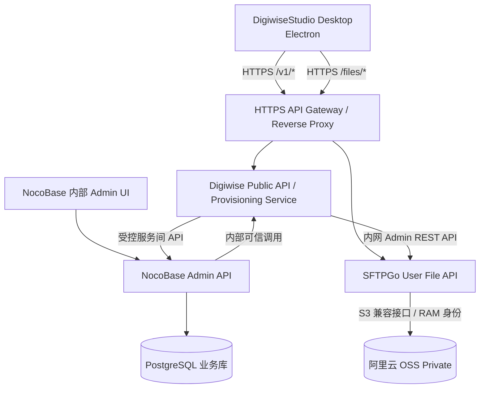

# DigiwiseStudio 桌面端 API 接入架构与边界

- 文档编号：API-DESIGN-001
- 版本：v0.1
- 日期：2026-11-10
- 状态：设计建议 / 未实现 / 待 NocoBase 和 SFTPGo PoC
- 关联：[后台与 OSS 方案](../architecture/digiwise-platform-and-oss.md)、[SFTPGo ADR](../adr/0001-sftpgo-file-plane.md)、[NocoBase 评估](../adr/0002-nocobase-internal-admin-evaluation.md)、[多项目接入规划](../architecture/multi-project-data-integration.md)

## 1. 关键结论

**NocoBase 的浏览器前端不提供接口；NocoBase 服务端提供数据表 REST API / 插件自定义 API。** DigiwiseStudio 桌面 IDE 不应直接调用拥有内部管理权限的 NocoBase API。推荐 API 分层：

1. **Digiwise Public API（业务控制面）**：提供 Desktop 使用的登录、账户信息、个人/组织 Workspace、授权、容量展示、软件更新。可由 NocoBase 后端插件或独立精简 Node.js 服务实现；对桌面端保持统一、稳定的版本化契约。
2. **SFTPGo User API（文件面）**：提供列目录、上传、下载和删除，不经过 Node.js 的字节流。用户文件接口经过 HTTPS 网关，并由 SFTPGo 用户级鉴权和授权控制。
3. **NocoBase Admin API（管理面）**：仅供内部管理员或受信任服务使用；负责企业、用户、席位、套餐、配额管理和流程，不暴露给普通客户端。
4. **SFTPGo Admin API（内部管理面）**：只有 NocoBase 的后端扩展或可信 Provisioning 服务通过内网调用，用于创建/撤销账号、组、共享目录、配额和映射。
5. **阿里云 OSS（存储面）**：Private，只有 SFTPGo 服务端可以访问；桌面端不得获取 OSS AccessKey、STS、预签名 URL 或对象直链。

## 2. 参考部署与流量



说明：图中 PUB ↔ NB 代表按明确业务 API 接口集成，避免相互读写非公开业务表；任何循环服务依赖须按实际模块梳理并消除。Public API 与用户级文件 API 在相同网关上展示两个路径，但**不应将 Admin API 的路径映射到公网**。

示例 DNS（纯示例，非真实已部署域名）：
- `api.example.invalid/v1/*` → Digiwise Public API。
- `api.example.invalid/files/*` → 受保护的 SFTPGo User API。
- `admin.example.invalid` → 内部 NocoBase 管理台（VPN/办公网络/安全认证）。
- SFTPGo Admin API → 私网内部服务地址，不经公网网关。

## 3. 推荐的 Desktop API 草案

以下均是**建议接口，不是已实现路径**，需开发时落入 OpenAPI：

| 方法 | Digiwise Public API | 用途 |
| --- | --- | --- |
| POST | `/v1/auth/login` | 登录，获取短期用户 Access Token 与安全续期机制 |
| POST | `/v1/auth/refresh` | 刷新 Token |
| POST | `/v1/auth/logout` | 退出并撤销会话 |
| GET | `/v1/me` | 个人资料 |
| GET | `/v1/workspaces` | 查询当前用户有权限的个人和企业 Workspace |
| GET | `/v1/workspaces/{id}` | 查询 Workspace 详情与角色 |
| GET | `/v1/workspaces/{id}/quota` | 从可靠配额同步服务读取额度与用量快照 |
| GET | `/v1/licenses/effective` | 查询当前账户/Workspace 的有效功能授权 |
| POST | `/v1/file-sessions` | 验权后请求 SFTPGo **用户级**文件会话，不返回 Admin Key |
| GET | `/v1/releases/latest` | 查询适用更新通道与软件版本 |

SFTPGo User API 具体路径以部署时锁定的版本 OpenAPI 为准。例如官方文档提供 `/api/v2/user/token`、`/api/v2/user/dirs`、`/api/v2/user/files/upload` 和 `/api/v2/user/files`。路径映射要确认反向代理是否去掉 `/files` 前缀，并测试 API 响应不含 OSS 重定向。

## 4. 账号认证与单点登录

- Digiwise 用户账号是统一身份源；桌面业务访问需要短时用户级 Access Token。
- Digiwise 的 JWT **不能默认直接用于 SFTPGo**。PoC 需确认 SFTPGo 外部认证 Hook、OIDC、User Token 交换或受限制的账户映射机制。
- 不应把 NocoBase 内部管理员 Token、后台 API Key、SFTPGo Admin Key 硬编码在 Electron 安装包、renderer、localStorage 或日志里。
- Electron 主进程管理 token 与网络调用，使用 OS 安全存储适当保护续期凭据；renderer 通过受限 IPC 调用业务方法，不提供通用任意 URL/任意密钥的 IPC。
- 每次访问 Workspace 验证用户成员关系；企业成员移除或 Workspace 冻结时，业务会话与 SFTPGo 文件会话必须及时同步失效。

## 5. NocoBase API 的适用边界

NocoBase 本身会为数据表提供 REST API（2.x 示例 `GET /api/users:list`），也可以由服务端插件注册自定义资源操作。**“有 REST API”不等于可以将 Admin 管理权限提供给桌面端**：

- 内部后台表单 CRUD：可以直接使用 NocoBase 管理 API，并使用管理员角色/数据权限。
- Desktop 查询个人、团队、授权：使用 Digiwise Public API；只暴露经过明确筛选的业务字段。
- Desktop 触发企业创建/成员加入：Public API 验证权限并执行业务流程，可由后端扩展调用 NocoBase 服务/数据层，避免使用 NocoBase 管理员账号代理每个客户端请求。
- Desktop 上传下载：使用 SFTPGo 用户文件 API，不使用 NocoBase 文件附件 API，也不从业务服务流经文件字节。
- 其他项目的数据接口：走项目独立服务 API 或受限的后台数据源连接，不能让 Desktop 以跨项目管理账号直接访问所有项目的数据库。

采用 NocoBase 后端插件实现 Public API 可减少一个进程，但必须隔离客户端角色、路由与管理权限。采用独立精简 Node 服务会增加部署单元，却能更清晰地分离管理面与公众 API。两种方式应在 PoC 中比较：开发工作量、授权复杂度、可审计性、扩容成本及未来其他项目复用。

## 6. Desktop 端示例（API 设计，不是可直接运行的项目补丁）

```typescript
// Electron 主进程的业务服务层示意；URL 是占位示例
async function getWorkspaces(accessToken: string) {
  const res = await fetch('https://api.example.invalid/v1/workspaces', {
    headers: { Authorization: `Bearer ${accessToken}` },
  });
  if (!res.ok) throw new Error(`HTTP ${res.status}`);
  return res.json();
}
```

对接需统一错误码、响应包结构、版本兼容、超时/重试/幂等、TLS 安全与日志脱敏。不要把任意访问 Token 暴露给不可信页面。

## 7. PoC 验收清单

- [ ] NocoBase 建立一个测试用户/企业，业务 API 查询只返回自己的 Workspace。
- [ ] 用普通 Desktop Token 请求 NocoBase 内部管理 API、SFTPGo Admin API 均被拒绝。
- [ ] 两个普通账号跨 Workspace 测试读写均拒绝，企业成员退出后文件会话失效。
- [ ] Desktop 登录后无需重新输入 SFTPGo 管理账号即可取得用户级文件权限。
- [ ] 上传/下载经 SFTPGo，不经过 Node 字节流；客户端无 OSS 凭据、直链或重定向。
- [ ] 业务 API 在 NocoBase 版本/后台布局升级后保持向后兼容。
- [ ] 令牌注销、丢失、过期与重放场景受控；审计中无敏感凭据。
- [ ] API 文档与版本号一并提交，线上未测试不得宣称已上线。

## 8. 官方参考

- NocoBase 资源 API：https://docs.nocobase.com/plugin-development/server/resource-manager
- NocoBase 服务端插件/API：https://docs.nocobase.com/core/extension-development/server-apis/
- SFTPGo REST API：https://docs.sftpgo.com/enterprise/rest-api/

## 9. 变更记录

| 日期 | 版本 | 内容 |
| --- | --- | --- |
| 2026-11-10 | v0.1 | 新增 Desktop API 与 NocoBase、SFTPGo、OSS 的责任边界和认证 PoC 要求 |
