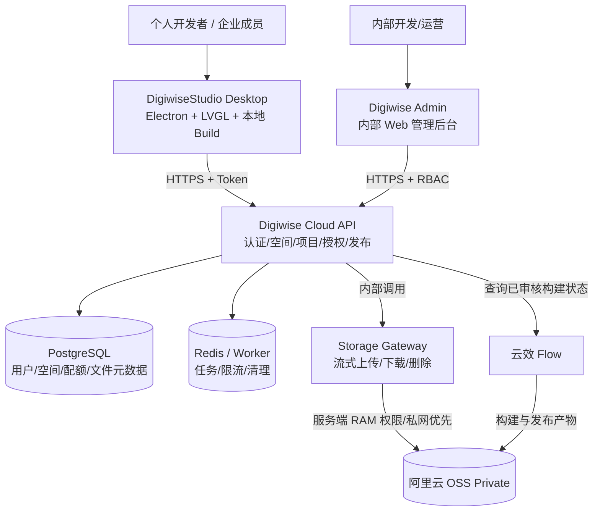
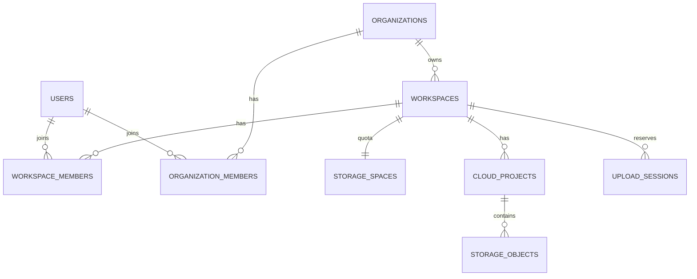
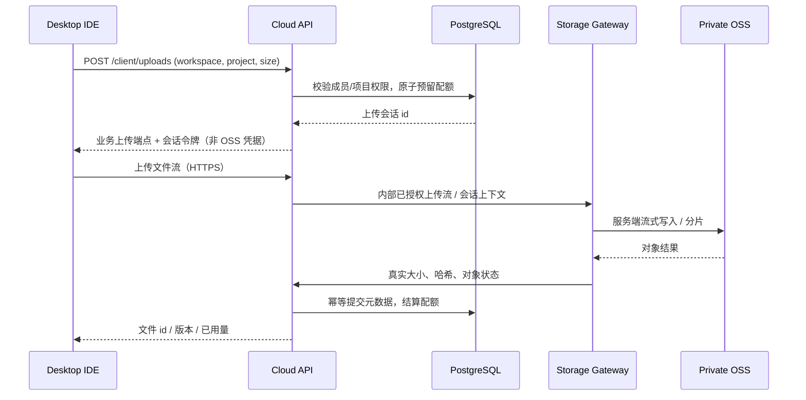

# DigiwiseStudio 后台与 OSS 整体技术架构方案

- 文档编号：ARCH-PLATFORM-001
- 版本：v1.0（架构草案）
- 日期：2026-11-10
- 状态：需求方向已确认，技术选型及实现待评审
- 涉及：DigiwiseStudio Desktop / Digiwise Admin / Digiwise Cloud API / Storage Gateway / PostgreSQL / Redis / 阿里云 OSS / 云效 Flow

## 1. 背景和边界

DigiwiseStudio 基于 EEZ Studio 进行桌面 IDE 开发，包含 LVGL 工程编辑、本地 Build、MCP 扩展和 Electron 自动更新。计划增加统一云服务，为个人和企业客户提供各自的工作空间及云文件存储，并供内部团队管理软件发行、资源、客户、授权及容量。

**已确认产品边界：**

1. 面向个人开发者和企业组织，使用**同一个桌面 IDE、同一个账号体系**。
2. **仅内部团队使用 Web 管理后台**，个人和企业客户均无需独立 Web 门户。
3. 一个个人账号可以同时拥有自己的个人空间，并加入多个企业空间。
4. 每个空间独立计算存储容量；企业成员共享企业配额，但按成员和项目权限访问文件。
5. **客户端绝不直接访问 OSS**：不获取 OSS AccessKey/STS/预签名 URL，也不调用公开 OSS 文件地址；文件上传下载由后端存储网关中转。
6. IDE 本地编辑、本地工程、本地 Build 不应因云服务故障而停止工作。
7. 继续复用现有阿里云云效与 OSS 发布链路，先不重做 CI 平台。

**非目标（本期不实施）**：企业 Web 门户、实时多人协同编辑、默认全盘自动同步、云端固件编译、支付系统、自动创建完整组件市场。

## 2. 总体架构



客户端只能访问 Cloud API 的业务域名；Storage Gateway 默认处于内部网络，不对互联网公开独立文件服务端口。云效构建产物可由受控发布管道管理；客户文件和发行包必须分 Bucket。

### 2.1 服务职责

| 部件 | 职责 | 不负责 |
| --- | --- | --- |
| Desktop IDE | 登录、切换 Workspace、本地编辑/编译、云文件上传下载、更新 | OSS 凭据和全局配额裁决 |
| Admin | 客户、组织、用户、空间、配额、版本、构建、资源、授权、监控、审计 | 直接替用户编辑工程 |
| Cloud API | 身份认证、RBAC、Workspace/项目授权、元数据、配额事务、上传会话、版本策略 | 大文件直接缓存在 API 内存 |
| Storage Gateway | API 已授权任务的流式传输、OSS CRUD、完整性验证、带宽/并发控制 | 决定业务所有权或跳过容量校验 |
| PostgreSQL | 事实记录、事务、空间及项目关联、预留量与审计 | 保存文件正文 |
| Redis / Worker | 异步清理、告警、限流、对账调度 | 作为唯一容量事实来源 |
| OSS | 对象持久化、生命周期、加密、版本化按策略配置 | 自行实现业务租户配额 |
| 云效 Flow | Windows/macOS 构建、签名、测试、制品发布 | 客户云项目存储授权 |

## 3. 用户、企业与工作空间

基础实体：`users`、`organizations`、`organization_members`、`workspaces`、`workspace_members`、`cloud_projects`、`project_members`。

- 用户注册后分配个人 Workspace（设计建议：自动创建）。
- 企业由内部管理员创建，或在 IDE 端发起申请并完成审批后开通；试用团队能否自助创建尚待产品决策。
- 企业开通涉及组织、初始所有者、Workspace、容量记录、许可证/席位，可通过带补偿的状态机完成；失败后可重试，不产生半开通可用空间。
- 成员使用同一账号加入企业，不自动转移个人工程；退出企业后个人空间保留，企业数据仍归企业。
- Workspace 是存储归属与权限域的核心，避免以 `user_id` 或企业名称作为 OSS 隔离标识。



个人 Workspace 通过 `owner_user_id` 归属用户；企业 Workspace 通过 `organization_id` 归属组织。两种归属互斥，数据库增加约束。

## 4. OSS Bucket 与对象 Key 设计

**设计建议：生产环境至少分三个 Private Bucket，测试环境另设独立 Bucket。**

| Bucket 示例名 | 内容 | 访问控制 |
| --- | --- | --- |
| `digiwise-customer-prod` | 个人/企业工程、素材、备份 | Private，仅网关服务端操作 |
| `digiwise-release-prod` | Stable/Dev 安装包、更新清单、签名产物 | 受控分发；若坚持所有文件仅通过服务器访问，则发行下载也走专属网关/CDN 授权代理 |
| `digiwise-resources-prod` | 工具链、模板、Style、插件及 MCP 分发包 | 受控分发 |

```text
digiwise-customer-prod/
  workspaces/
    ws_<opaque-id>/
      projects/<project-id>/<object-id>
      assets/<object-id>
      backups/<backup-id>/<object-id>
      exports/<object-id>
```

OSS 为对象前缀而非真实文件夹。对象 Key 必须由后端生成，用户原始文件名仅存数据库。客户前缀实现逻辑隔离，不等于独立账号级或物理隔离；高安全客户可升级到独立 Bucket，迁移和授权方案另立 ADR。

## 5. 配额与严格并发控制

`available_bytes = quota_bytes - used_bytes - reserved_bytes`，上述计数以数据库事务为准，所有长度均用 BIGINT bytes。

- 申请上传时根据 Workspace 加锁或原子更新，验证用户/项目权限、空间状态、文件尺寸和剩余容量，创建 `upload_sessions` 并预留 `reserved_bytes`。
- 对象不可被用户直接写入/覆盖；网关只能处理已经授权且未过期的上传会话。
- 服务端边接收边统计流量与对象大小，超出会话允许大小立即中断；不得因 HTTP chunked body 无 Content-Length 而放弃限制。
- 成功后网关从 OSS 核验对象真实大小、ETag/校验信息和 Key，事务提交 `storage_objects`，将预留转为已用，记录用量事件。
- 失败、超时、取消及服务重启时通过幂等补偿清理暂存对象/未完成分片并回退预留量。
- 替换文件采用新对象写入、版本提交、旧对象按回收策略清理；统计逻辑需同时考虑新旧对象占用。
- 多设备并发上传、请求重试、配额缩小、空间冻结、软删除与恢复都需要测试。
- **提醒阈值设计建议**：80% 预警、95% 高容量提醒、100% 拒绝增长；不得自动删除工程。
- 文件版本、回收站、OSS 版本化、备份对象是否计入计费和逻辑配额，应分别说明；不能将 `used_bytes` 视为 OSS 账单用量。

## 6. 上传与下载安全数据流



下载：IDE 请求文件 ID → API 验证 Workspace 和项目权限 → 网关从 OSS 读取流 → API/网关经受控入口流式返回。严禁重定向到 OSS 对象 URL；不提供客户端 STS/签名 URL。支持 Range 下载、断点续传、流量限速与审计。大型工程传输避免整文件加载内存。

网关流式传输会增加应用网络出流量和算力成本，需做峰值并发、GB 级文件、客户端断线和出口费用的专项压测。

## 7. 后台规划（仅内部使用）

| 一级模块 | 页面及功能 | 阶段 |
| --- | --- | --- |
| Dashboard | 用户/组织/空间、容量、构建发布、告警 | P0 |
| Users | 个人账号、禁用、会话/设备、审计 | P0 |
| Organizations | 企业创建、审核、成员、初始负责人、状态 | P1 |
| Workspaces | 空间列表、个人/企业类型、归属、状态、权限 | P0 |
| Storage | 配额调整、用量、文件元数据、传输记录、对账、回收 | P0 |
| Releases | Stable/Dev、版本、元数据、灰度/暂停、审核、回滚策略 | P0 |
| Builds | 云效流水线、记录、产物、签名与校验 | P0 |
| Resources | SDK、工具链、工程模板、主题、组件、MCP/插件 | P1 |
| Licenses | 个人许可、企业席位、设备激活、有效期 | P1 |
| Monitoring | API/网关错误、容量告警、审计、任务重试 | P0 |
| Settings | 内部管理员/RBAC、系统参数、操作记录 | P0 |

企业员工在 IDE 内查看和切换工作空间、使用企业云项目；邀请/角色管理需明确组织成员权限，不因此建设企业 Web Portal。所有后台的“客户文件查看”默认仅允许元数据，不应开放读取客户工程正文的通用超管能力。

## 8. 软件发行与公共资源

保留现有云效 + OSS。构建产物路径以 `channel/platform/version/build-number/` 等不可变版本目录存储；更新通道元数据独立维护，Stable/Dev 隔离。发布需审核签名、哈希、平台、兼容性与回归结果。旧版本回滚需符合 Electron Updater 的版本比较规则，不假定已安装高版本能直接降级。

工具链、模板、Style 和插件都通过版本化资源清单分发，记录平台、文件哈希、兼容 IDE 版本及发布状态。MCP 后台可管版本与能力清单，但 MCP 属性/工具调用能力仍要在本地 MCP 代码中实现。

## 9. 数据库与接口草案

关键数据表（第一期重点标 *）：

- `users`*、`organizations`、`organization_members`、`workspaces`*、`workspace_members`*；
- `storage_spaces`*、`storage_objects`*、`upload_sessions`*、`storage_usage_events`*、`storage_reconcile_runs`*；
- `cloud_projects`*、`project_members`、`file_revisions`；
- `app_versions`*、`release_channels`*、`release_artifacts`*、`build_runs`*；
- `license_plans`、`licenses`、`license_seats`；
- `admin_users`*、`admin_roles`*、`admin_audit_logs`*、`background_jobs`*。

所有带空间归属的数据表建立 `workspace_id` 索引；后台查询及 API 操作均须执行真实租户边界检查。容量预留使用事务、约束和幂等键，不能依赖 Redis 作为唯一数据源。

API 草案（需单独落 OpenAPI 文件）：

```http
POST   /client/auth/login
GET    /client/workspaces
GET    /client/workspaces/{id}/usage
GET    /client/projects
POST   /client/uploads
PUT    /client/uploads/{id}/content
POST   /client/uploads/{id}/complete
POST   /client/uploads/{id}/abort
GET    /client/files/{id}/content
DELETE /client/files/{id}
GET    /client/releases/latest

GET    /admin/users
POST   /admin/organizations
GET    /admin/workspaces
PATCH  /admin/workspaces/{id}/quota
GET    /admin/storage/reconciliations
GET    /admin/releases
POST   /admin/releases/{id}/publish
GET    /admin/builds
GET    /admin/audit-logs
```

业务错误码至少包括：`UNAUTHENTICATED`、`FORBIDDEN`、`WORKSPACE_SUSPENDED`、`QUOTA_EXCEEDED`、`UPLOAD_EXPIRED`、`FILE_CONFLICT`、`TRANSFER_INTERRUPTED`、`STORAGE_UNAVAILABLE`。

## 10. 技术选型与部署建议

| 层 | 建议 | 状态 |
| --- | --- | --- |
| Admin 前端 | React + TypeScript + Ant Design Pro | 待选型 |
| API | NestJS 模块化单体 | 待选型 |
| Storage Gateway | 独立进程/容器 + OSS SDK 流式中转 | 待实现 |
| 数据库 | PostgreSQL | 待部署 |
| 队列与限流 | Redis + Worker | 待部署 |
| 对象存储 | 阿里云 OSS 三 Bucket + dev/prod 隔离 | 规划 |
| CI/CD | 延续云效 Flow，构建制品受控发布 | 延续现有 |
| 运维 | 指标/日志/链路追踪/备份恢复 | 待建立 |

部署建议：独立 API 与网关进程，网关可水平扩容；入口 HTTPS + WAF/限流；内部服务在私有网络访问 OSS，RAM 最小权限；数据库自动备份及可验证恢复；密钥放专用密钥管理，不放源码/配置明文。测试与生产数据、Bucket、数据库和凭据必须隔离。

开源选型（SFTPGo/Cloudreve 等）须专项验证许可证、OSS 兼容性及**是否确实不向客户端暴露 OSS**；不将候选产品当作已确定依赖。

## 11. 安全与风险

- OSS Bucket Private、服务端 RAM、禁止客户端 OSS 凭据和直接 URL。
- API 强制 Workspace/Project 权限，防止只用客户端传来的 workspace_id 做授权。
- 管理 API 和 Client API 分离，审计所有高权限动作；管理员默认不读取用户文件正文。
- 支持单文件上限、请求限流、网关背压、上传超时、恶意文件与资源滥用检测策略。
- 云端故障时 IDE 本地功能可离线继续；上传有断点/重试与幂等恢复。
- 处理客户工程的个人信息、删除申请、保留期及跨境存储地域需进行合规评审。
- 发行版涉及 EEZ Studio GPLv3 派生代码，商业授权及源码分发义务应独立法律审查。

## 12. 分阶段实施与验收

### P0：基础平台与个人空间

- 内部 Admin 登录/RBAC、Dashboard 基础指标、用户与 Workspace 列表。
- 个人账号、Personal Workspace、OSS Private、网关上传下载和文件列表。
- 严格并发配额预留、取消/失败补偿、对账、日志和审计。
- 复用云效 OSS 更新，建立文档及验收追踪。

**验收**：客户 A 无法访问 B；客户端无 OSS 凭据及 OSS 重定向；10 GB 配额在 2 台设备并发上传中不超卖；网关重启后会话可回收；本地 Build 不依赖云服务。

### P1：企业与运营

- 企业创建/审批、成员邀请、企业 Workspace、企业共享配额和席位。
- 软件资源中心、授权、客户存储回收机制、错误告警。
- 组织与个人空间切换、项目访问控制、空间迁移的显式审批。

**验收**：用户可同时属于个人和两个企业空间；退企业不影响个人空间；不同企业数据完全隔离；企业成员角色不能越权。

### P2：规模化与商业化

- 套餐/订阅、自动扩容、历史版本、可选同步、运营报表、成本与流量配额。
- 大文件高并发网关扩容、限速、容灾、多 Bucket/地域策略。

**验收**：流式传输压测、对象元数据对账、备份恢复演练及可审计收费口径。

## 13. 待评审决策

1. 企业工作空间可否由个人自助创建？正式企业是否需后台审核？
2. 默认个人/企业配额、单文件上限、回收站保留期和流量上限。
3. 客户上传备份和文件历史是否计入逻辑配额。
4. OSS Bucket 所在地域、跨区域与国际客户的数据驻留要求。
5. Storage Gateway 使用自研 OSS SDK 还是经严格安全验证的开源网关。
6. 对发行安装包是否同样要求全量服务端中转，或允许 CDN 受控分发。

以上属于待决策项，不能作为现有实现或已获批准功能处理。

## 14. 变更记录

| 日期 | 版本 | 内容 |
| --- | --- | --- |
| 2026-11-10 | v1.0 | 确立内部后台、个人/企业统一 Workspace、OSS 服务端中转、严格配额与文档规范 |
