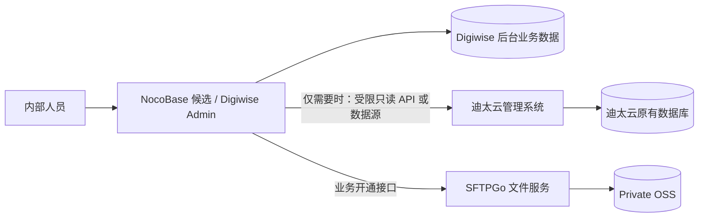

# 迪太云管理系统数据接入 Digiwise 后台的预留设计

- 文档编号：ARCH-INTEGRATION-001
- 版本：v0.2（范围修订）
- 日期：2026-11-10
- 状态：可选未来集成 / 未实施 / 数据库结构与具体字段待核实
- 关联：[NocoBase 后台评估](../adr/0002-nocobase-internal-admin-evaluation.md)、[Digiwise 后台总体架构](digiwise-platform-and-oss.md)

## 1. 已明确的实际范围

当前并不是建设多个产品的统一管理平台。DigiwiseStudio 的内部后台先服务 DigiwiseStudio 的账号、企业、许可、开通和 SFTPGo 存储管理。**另有一个已存在的“迪太云管理系统”，未来可能需要读取其中部分数据并在同一内部后台查看**。

- 迪太云仍是独立系统，数据库归属、升级、备份、业务逻辑均由原系统维护。
- 接入是可选功能，现阶段**不要求**统一登录、跨项目用户合并、跨系统写数据、共享工作流或集中管理全部产品。
- 暂未确认迪太云的数据库类型、API 可用性、实际需要的字段和数据分类。不能将 PostgreSQL/MySQL/SQL Server 任何一种写成已确认技术事实。
- SFTPGo + OSS 继续只承担 Digiwise 的用户文件服务，与迪太云数据接入无直接依赖。

## 2. 最小目标拓扑

这里的“只读”是第一阶段的安全默认建议，不代表用户已确认只能读取。未获得明确需求前，不设计跨系统写回或共用数据库。

## 3. 两种接入方式

| 方式 | 适用情况 | 约束 |
| --- | --- | --- |
| **优先：迪太云现有 API** | 原系统有查询 API，且需要保留业务鉴权/计算逻辑 | 使用服务账号或受控服务间身份；仅获取获准字段；设置超时、限流、缓存和故障隔离 |
| **备选：只读数据库接入** | 确实没有合适 API，仅需要少量列表、统计、报表 | 独立只读账号、视图或只读副本、网络白名单、字段权限、查询限额；不可管理迪太云业务表结构 |

若采用 NocoBase，外部数据库插件的社区版/商业版限制与所选 2.x/3 版本有关，应在确认迪太云实际数据库后按版本核价；不能仅因预留的单个外部系统就提前购买昂贵插件或改换平台。

## 4. 优先级与实施条件

1. **P0：不接迪太云**。先验证 Digiwise 后台个人/企业账号、邮箱开通、软件授权、SFTPGo 存储空间创建和配额管理。
2. **P1：确有业务需求时**，明确要显示的迪太云字段/页面、原系统负责人、数据敏感等级、是否有现成 API 和网络访问条件。
3. **P2：做最小只读 PoC**，只实现一个有明确业务价值的查询页，比较 API 和数据库两条路径的维护成本。
4. 通过权限、性能、容错、安全与费用评审后，再决定是否将集成正式纳入 Digiwise Admin。

## 5. 安全与验收

- [ ] Digiwise 后台失去迪太云连接时，DigiwiseStudio 用户管理、授权和存储服务照常运行。
- [ ] NocoBase 不自动修改迪太云数据库结构，不跨库写入核心事务数据。
- [ ] 迪太云接口/数据库凭据仅在受控服务端保存，不出现在浏览器或桌面软件中。
- [ ] 仅内部有权限人员可查看获准的字段；敏感数据应最小化、脱敏并审计访问。
- [ ] 明确访问方式、所需字段、同步时效、原系统负责人及维护责任后才实施。

## 6. 对后台选型的影响

**只有一个未来可能接入的既有外部系统，不足以作为将 NocoBase 更换为 Budibase 的主要理由。** 当前优先按内部业务关系、授权流程、SFTPGo API 集成、安全性和总体维护成本选型。

## 7. 变更记录

| 日期 | 版本 | 说明 |
| --- | --- | --- |
| 2026-11-10 | v0.1 | 原泛化多项目数据源规划（已被 v0.2 收窄） |
| 2026-11-10 | v0.2 | 明确唯一已知外部系统为迪太云管理系统，接入可选且优先只读，不建设通用多项目运营平台 |
