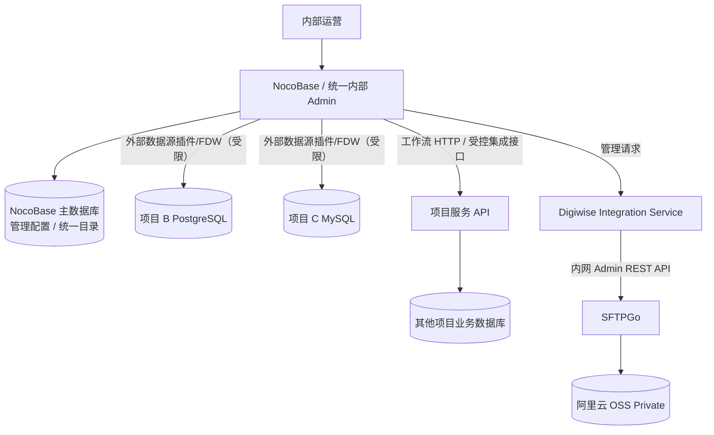

# Digiwise 统一管理平台：多项目数据源接入规划

- 文档编号：ARCH-INTEGRATION-001
- 版本：v0.1（预研草案）
- 日期：2026-11-10
- 状态：**未来能力规划 / 未实施 / 未确认具体项目及数据库**
- 关联：[后台候选 NocoBase ADR](../adr/0002-nocobase-internal-admin-evaluation.md)、[后台与 OSS 架构](digiwise-platform-and-oss.md)

## 1. 需求与边界

考虑将 NocoBase 作为 Digiwise 多个独立产品的统一**内部**管理控制台。除 DigiwiseStudio 外，后续可能接入其他项目的 PostgreSQL、MySQL、MariaDB、SQL Server 或 REST API，统一展示用户/组织/授权、运营指标和故障，但不要求将所有业务数据库合并，也不赋予后台绕过各项目业务权限的权利。

原则：**项目数据库独立，业务所有权独立；统一管理界面与跨项目报表在管理层聚合**。SFTPGo/OSS 只管理经批准的文件面，不因接入外部数据源而暴露 OSS。

## 2. 逻辑架构

不要让外部业务数据库成为 NocoBase 主数据库；不同项目的迁移、备份和故障恢复仍由其原系统负责。

## 3. 可选连接方式与版本/费用边界

| 模式 | 适用 | 价格/限制 |
| --- | --- | --- |
| 官方外部数据库数据源插件 | 可视化挂接整个独立业务库，按表、字段、权限、页面、流程使用 | **NocoBase 2.x 的 MySQL/PostgreSQL/MariaDB/MSSQL 外部数据源为 Standard+**，非 Community；对应商用插件需要授权 |
| Community FDW 外部数据表 | PostgreSQL/MySQL 个别外部表的只读报表/轻量展示 | 1.x/2.x 社区版包含 `@nocobase/plugin-collection-fdw`，底层数据库需 FDW/FEDERATED 支持；属于逐表映射，有远程查询与结构约束，不等同完整数据源管理 |
| 工作流 HTTP Request | 调用其他项目已有的业务 API 做通知、状态同步、管理动作 | 2.x Community 含 HTTP 请求工作流节点；不等于外部 REST 数据源的 CRUD 页面插件 |
| 官方 REST API 数据源 | 把第三方 API 映射为可视化数据源页面 | 1.x/2.x 的 `@nocobase/plugin-data-source-rest-api` 是 **Standard+**，不是 Community |
| 自定义 Node/NocoBase 插件 | 深度集成复杂业务，或避开商业数据源插件、需要高安全隔离 | 需自行实现认证/授权、字段映射、缓存、错误、测试与运维；开发成本不能视为零 |
| NocoBase 3 外部数据库连接（代码） | 使用 3.x 代码化应用，读取现有数据库架构并绑定权限 | 使用 `schemaManagement: 'external'`；表示不由框架迁移 DDL，不代表数据库读写权限自动变为只读。须按目标版本验证部署与界面体验 |

版本差异必须锁定：**2.x 的低代码外部数据源插件价格不能直接套用到 3.x 核心代码化数据库连接**。

## 4. 安全架构

1. **优先 API 集成**处理修改客户资料、授权、订单、设备等有业务规则的操作；不允许 NocoBase 绕过目标项目服务而直接更新核心事务表。
2. 数据库直连用于只读查询、审计/统计或明确批准的 CRUD；使用独立低权限 DB 账号，优先只读副本和 View；网络仅允许内部私网/VPN，TLS 加密，凭据存安全的后端密钥服务。
3. 每个外部项目配置数据源别名、owner、数据分类、权限范围、接口/表结构版本、故障处理和容量上限。不可通过普通 UI 配置暴露他人数据库密码。
4. 跨数据库操作不具备自动分布式事务；涉及跨项目写操作必须实施幂等、补偿与对账流程。
5. 多项目管理不等于统一用户登录：如需统一客户身份，应新增中央账户映射和 SSO 设计；不要简单地跨库复用用户 ID。
6. 数据源异常必须隔离，不应导致 NocoBase 其他模块或各项目客户端停机。

## 5. 建议路线

### P0：现在
- 保持 DigiwiseStudio 与 SFTPGo 的业务/文件面清晰分离。
- NocoBase 选型 PoC 先验证内部客户/组织/存储配额管理及 SFTPGo Admin API。
- 先定义标准的 project_id、external_user_id、data_source_id 映射表，避免未来跨系统 ID 冲突。

### P1：第一个外部项目
- 优先挑选一个外部项目的只读列表/报表进行验证，比较 Community FDW、官方 Standard 外部数据库插件与业务 API。
- 验证读权限、分页、查询性能、字段变更、凭据轮换、断连恢复与数据库网络边界。
- 根据插件购买成本与二次开发成本决定采用官方插件还是自定义集成。

### P2：多项目管理
- 统一内部项目目录、权限与审计，形成项目级概览指标；再逐个引入修改类管理操作。
- 保持每个业务数据库独立迁移和备份，统一后台不得代替各项目运维。

## 6. 验收与风险

- [ ] 外部项目 DB 单独维护，其 schema 变化不由 NocoBase 自动修改。
- [ ] 只读管理员无法通过 API 或表单修改外部业务数据。
- [ ] 数据源凭据和客户数据不进入前端或日志。
- [ ] 单个外部 DB 中断不影响其它项目管理界面及 DigiwiseStudio 本地能力。
- [ ] 线上环境已核对 NocoBase 2.x/3 的实际插件与许可证。
- [ ] 跨项目管理动作经过目标业务 API，能审计且具备重试/补偿。

## 7. 官方参考

- NocoBase 外部数据库及商业版限制：https://nocode.docs.nocobase.com/data-sources/data-source-manager/external-database
- NocoBase 2.x 社区版 FDW：https://docs.nocobase.com/data-sources/collection-fdw/
- NocoBase 外部 REST API 插件：https://docs.nocobase.com/cn/plugins/%40nocobase/plugin-data-source-rest-api/
- NocoBase 3 外部数据库编程指南：https://docs.nocobase.com/core/developing-apps/existing-databases/
- NocoBase 2.x HTTP Request 工作流：https://docs.nocobase.com/plugins/

## 8. 变更记录

| 日期 | 版本 | 说明 |
| --- | --- | --- |
| 2026-11-10 | v0.1 | 新增未来多项目数据库、API 及平台化管理规划；尚未选型/实现 |
